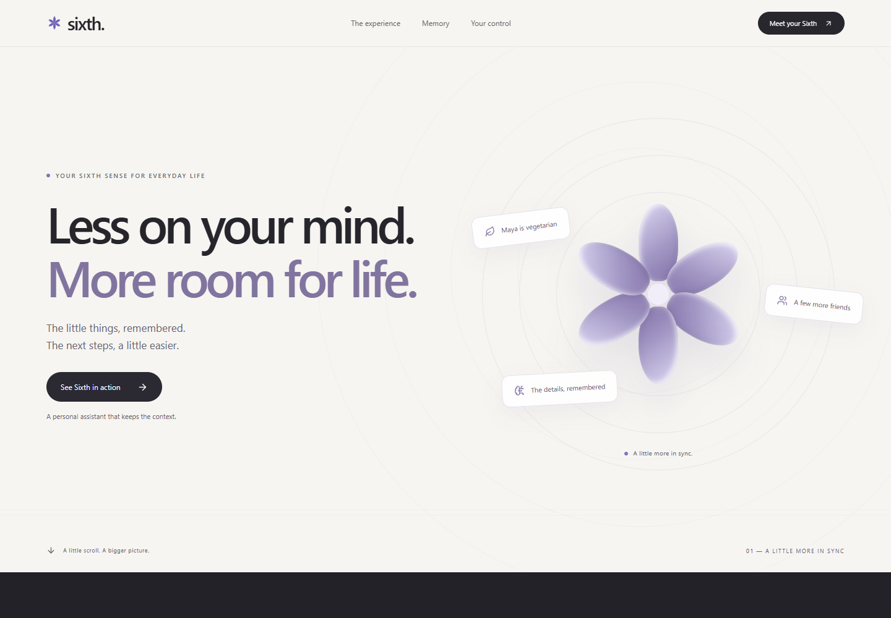
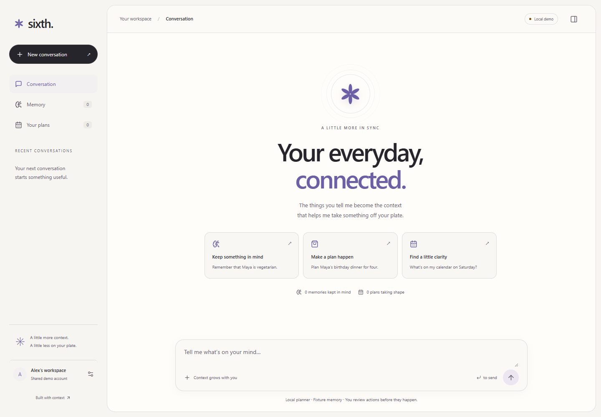

# Sixth

**Less on your mind. More room for life.**

Sixth is a personal assistant that remembers the context behind your requests. Tell Sixth about a preference, then use that preference in a later conversation. You can inspect the source of a memory, correct the memory, and review a proposed action before it runs.

[Open Sixth](https://sixth-one.vercel.app/) · [Documentation](docs/README.md) · [Local setup](docs/getting-started.md)



## What Sixth does

Sixth connects people, preferences, events, and plans through a memory graph. The current application uses that context for dinner planning, a sandbox shopping cart, and internal availability with friend invitations.

Set a profile status or save a busy slot in **Availability**. You can ask accepted friends about a time, send an invitation, and confirm a booking after everyone accepts. Free/busy access and selected memories require explicit sharing. See [profile availability](docs/26-profile-availability.md).

For example, tell Sixth, `Maya is vegetarian.` In a new conversation, ask, `Plan Maya's birthday dinner for four.` Sixth uses the saved preference when it selects a recipe. If two more guests join, Sixth can revise the quantities. A temporary restriction can apply to that dinner without replacing Maya's saved preference.

Select **Why this plan?** to inspect the evidence. Select **Prepare test cart** to approve the sandbox action. The cart does not place a real order.

## Inside the app

- Chat across saved conversations and receive streamed task updates.
- Review sourced memories, correct preferences, and forget selected memories.
- Create dinner plans with guest quantities, dietary restrictions, and sample pantry data.
- Inspect the sources that informed a plan before you approve a test cart.
- Use Google sign-in and manage friend requests by username. Friendship alone grants no access. Each user can share free/busy information or selected memories. Conversations stay private.
- Choose Paper, Dusk, or Grove. The interface supports narrow screens, keyboard controls, and reduced motion.

The landing page includes a scroll-driven product demonstration and an animated technology wheel.



## How memory works

FalkorDB stores the connections between people, preferences, sources, events, and plans. A plan links to the memories that informed it. This lets Sixth retrieve relevant context and show the reason for a choice.

The operational database stores accounts, sessions, messages, tasks, and workflow progress. The hosted app uses PostgreSQL. Local development uses SQLite unless you configure PostgreSQL. These stores have different roles; the app does not copy every chat message into FalkorDB.

| Part | Technology |
| --- | --- |
| Interface | React, TypeScript, Vite, CSS |
| API | Python, FastAPI |
| Persistent workflows | LangGraph |
| Connected memory | FalkorDB |
| Operational storage | PostgreSQL when hosted; SQLite by default locally |
| Optional intent parsing | An OpenAI-compatible model endpoint |

The default local configuration uses fixture memory and a deterministic planner. Configure FalkorDB to use the real memory graph. FalkorDB mode does not silently fall back to fixture memory.

## Try Sixth

[Open the hosted app](https://sixth-one.vercel.app/) to view the landing page and use Google sign-in. A live Google account check verified message sending, sourced memory, and persistence after reload. Hosted Alex and Jordan demo login is disabled.

To run the app yourself, follow the [local setup guide](docs/getting-started.md). The guide covers Google sign-in, a local sample-account session, FalkorDB, model configuration, and checks.

## Current scope

Personal profiles use saved internal availability slots and confirmed invitations. Demo calendar events, recipes, pantry contents, and prices use sample data. The shopping flow prepares a sandbox cart. External calendar access, external bookings, real purchases, voice, and general browser actions are outside the current implementation. WhatsApp has an optional test connector, but live messaging is disabled.

The [database verification report](docs/24-database-verification.md) records the latest checks and limits. Local SQLite application tests and real FalkorDB integration tests passed. A fresh hosted demo-account workflow remains unverified because demo login is disabled. The latest local PostgreSQL suite did not complete.

## Documentation

Start with the [documentation index](docs/README.md) for setup, architecture, API contracts, deployment, testing, and research. Product proposals are listed separately from implementation and verification records.

## Hackathon: graph model and queries

Tracks: **Agents That Act on Connected Data** and **Agent Memory and Coordination**.

The implemented FalkorDB memory model uses these paths:

```text
(Person)-[:ATTENDS]->(Event)<-[:FOR_EVENT]-(Plan)-[:USES_RECIPE]->(Recipe)
(Plan)-[:BASED_ON]->(Assertion)-[:HAS_SUBJECT]->(Person)
(Assertion)-[:SUPPORTED_BY]->(Source)
```

An assertion stores its status, predicate, scope, version, and serialized fact payload. A source stores the original excerpt and capture time. The server selects a separate graph namespace for each user. PostgreSQL holds hosted accounts, conversations, and workflow state; FalkorDB supplies the connected memory used to build plans and their evidence.

This is the event-context query executed by the [memory adapter](apps/api/sixth/memory.py):

```cypher
MATCH (p:Person)-[:ATTENDS]->(e:Event {id:$event_id}),
      (a:Assertion)-[:HAS_SUBJECT]->(p),
      (a)-[:SUPPORTED_BY]->(s:Source)
WHERE a.status='confirmed'
  AND (a.scope_type='person'
       OR (a.scope_type='event' AND a.scope_id=$event_id))
RETURN DISTINCT a.payload
```

The adapter also writes `BASED_ON` edges from plans to the assertions used in each revision. In FalkorDB mode, unavailable graph memory is reported as an error rather than replaced with fixture memory. The separate local fixture mode exists for development and tests. See [local setup](docs/getting-started.md), the [implemented adapter](apps/api/sixth/memory.py), and [graph integration tests](tests/test_falkordb.py). The broader [query examples](examples/graph/queries.cypher) include design templates beyond the implemented query above.

The October 18 hosted demo exercised saved memory, a new-conversation dinner plan, a revision for six guests, the FalkorDB evidence panel, an approved sandbox cart, and a memory correction through Google sign-in. Demo people and dietary details are synthetic; recipes, pantry contents, and prices are sample data. No purchase was made.

### AI assistance disclosure

OpenAI Codex assisted with implementation, debugging, documentation, browser verification, and demo production. Gemini generated the demo narration. The demo uses recorded interactions with the hosted app. Verification records and current limitations are linked above.
