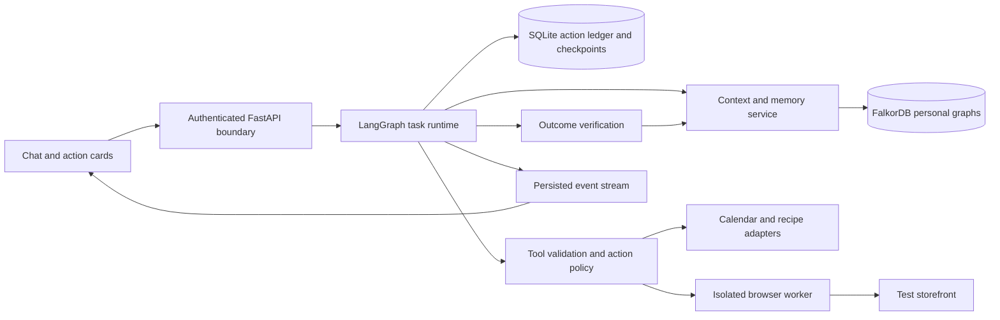
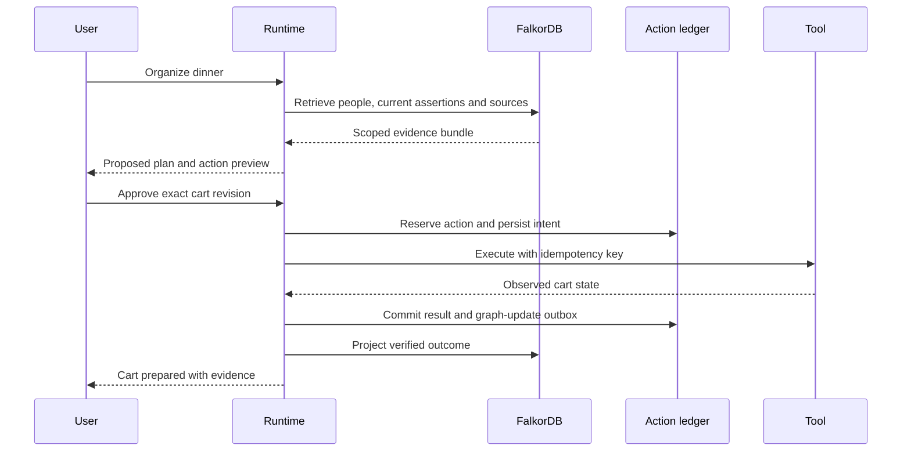

# System architecture

Status: proposed. [Architecture decisions](17-architecture-decisions.md) record the choices and alternatives.

## Responsibility boundaries

The frontend renders messages, tool progress, plans, review cards and evidence. It never receives database credentials, provider tokens, or an unrestricted browser connection.

The API resolves identity, checks ownership, validates inputs, creates tasks, and streams persisted events. The runtime plans with evidence, asks for missing data, and calls typed tools. It never constructs graph names from user text or gives a model arbitrary database access.

The memory service alone writes Sixth assertions. The browser worker gets only task-specific instructions and minimum required context. Connector credentials stay in a server-side credential broker. Browser screenshots and downloaded documents are untrusted observations.

## Storage ownership

| Store | Authoritative contents |
|---|---|
| FalkorDB | Personal entities, sourced assertions, plan dependencies, decisions and verified outcome relationships |
| Operational SQL | Accounts, conversations, workflow checkpoints, action ledger, event offsets, approvals and outbox |
| Artifact storage | Uploaded files, screenshots and provider responses, keyed by user and source |
| Provider | Live calendar, current inventory or external cart state |

FalkorDB is central even though it is not the only database. SQL durability does not replace graph context. Do not use a second graph database in the primary path.

## One request

## Consistency and failure recovery

SQL and FalkorDB do not share a transaction. Commit the action record and outbox item together in SQL, then apply an idempotent graph projection using a stable outcome ID. Retry projection until applied. Graph failure after a successful external action must not trigger the action again.

Checkpoint replay can re-enter a workflow node. Side effects therefore pass through the action ledger, which returns a recorded result or reconciles uncertain provider state before any retry. Graph memory is a retrieval layer; it is not an exactly-once execution mechanism.

## Concurrency and budgets

Serialize modifications to one user's active plan/cart using a task lease and optimistic revision. Independent read-only lookups can run concurrently. Start with one worker and bounded parallel reads. Cap model turns, browser steps, wall time, tokens and retry count per task; surface partial completion on exhaustion.

## Compatibility work remaining

Run startup and restart tests against pinned LangGraph, its SQLite checkpointer, the FalkorDB client, browser-use and the chosen model. A README example or matching Python version is not proof that the combined stack works.
