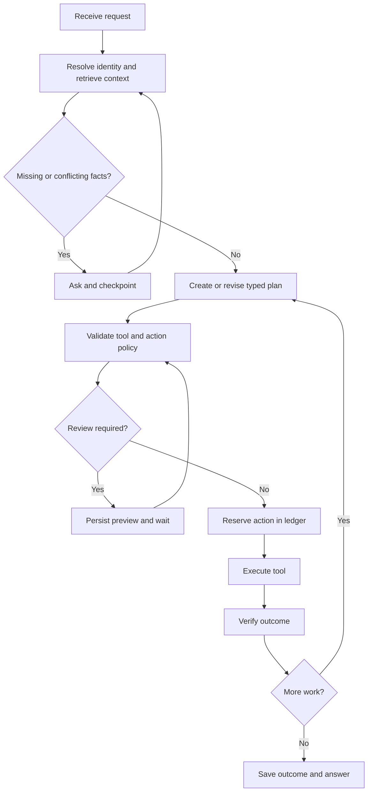
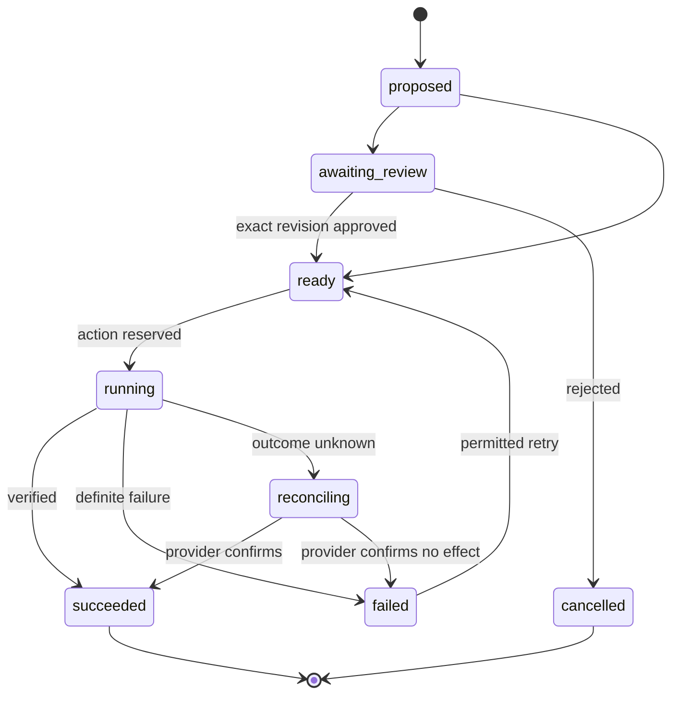

# Agent orchestration and execution

## Runtime graph

Use LangGraph nodes for these stages. Start with one coordinating agent and deterministic tools. Context preparation and execution can become separate specialist nodes that share the same persisted task. Multi-agent theater adds no value unless a real handoff changes what happens.

## Task state

Persist task ID, owner ID, conversation ID, user intent, resolved entities, evidence references, plan revision, typed steps, tool observations, next step, pending question, approval references, budget and cancellation flag. Keep credentials outside state. Resolve artifact references lazily rather than embedding full uploads in every checkpoint.

## Action state machine

An ambiguous timeout is reconciling, not automatically failed. Read provider state before retrying a mutation.

## Execution guarantees

Compute an action fingerprint from owner, tool, canonical arguments, plan revision, target resource and relevant evidence versions. The SQL ledger has a unique idempotency key, attempt records and observed result. Approval binds to this exact fingerprint and expiry. A worker claims a lease, records intent, calls the provider, records observations, and enqueues the graph projection.

Provider idempotency keys reduce duplicates when supported. Without them, use resource reconciliation and explicitly document residual ambiguity; do not claim exactly-once execution across arbitrary websites.

## Tool results

Return `status`, `data`, `evidence`, `external_refs`, `simulation`, `verified_at`, `retryable`, and a structured error. A completion sentence from the model does not verify an action. An adapter checks cart contents or calendar event IDs independently.

## Failure and interruption

Bound retries for transient failures with backoff. Replan for changed availability or invalid assumptions. Ask the user for identity ambiguity or unsupported account access. Stop new steps when cancelled. If a mutation is in flight, retain reconciliation state and report it accurately.

LangGraph interrupts may restart the containing node; keep side effects in ledger-protected execution nodes, separate from question/review nodes. A durable checkpoint alone does not make external effects safe to replay.

## Prompt contracts

The coordinator receives trusted intent, bounded context and permitted tool schemas. Source documents and web pages enter as labeled observations, never higher-priority instructions. Return structured plans with evidence IDs. The final response distinguishes completed, prepared, simulated, and unresolved work and cites observations supporting each claim.

Reference: [LangGraph source review](research/repositories/langchain-ai--langgraph.md).
